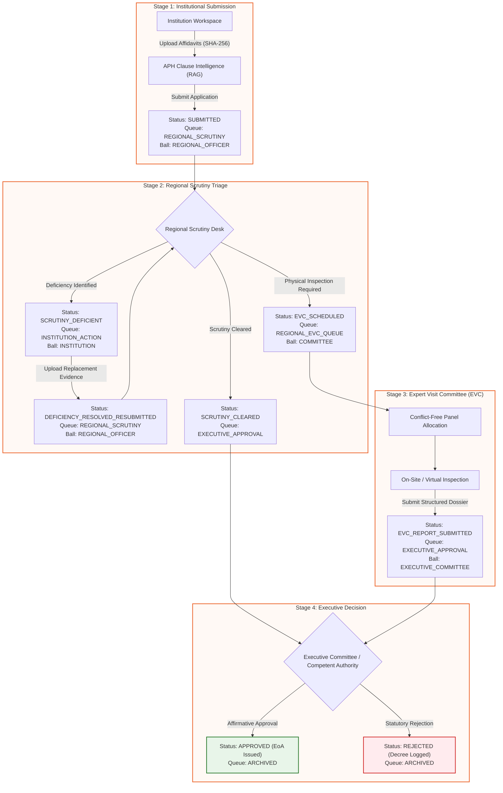

# SAMAY — Smart AICTE Monitoring & Approval Yojana

<div align="center">


-000000?style=for-the-badge&logo=next.js&logoColor=white>)


<br/>

**A unified, AI-native, legally defensible statutory regulatory platform orchestrating institutional approval workflows, compliance monitoring, and inspection panel governance for the All India Council for Technical Education (AICTE).**

[Explore Live Workflows](#-key-architectural-pillars) • [Architecture](#-monorepo-architecture) • [Getting Started](#-getting-started--installation-guide) • [APH RAG Engine](#1-dynamic-aph-rag-intelligence-engine) • [API & State Machine](#2-transactional-state-machine-dispatch-pipelines)

</div>

---

## 🏛️ Executive Summary & Value Proposition

**SAMAY** (_Smart AICTE Monitoring & Approval Yojana_) transforms the complex statutory operations of the All India Council for Technical Education into an automated, transparent, and auditable digital nervous system. Governing over 10,000+ technical institutions, engineering colleges, polytechnics, and management institutes across India, SAMAY codifies the canonical **AICTE Approval Process Handbook (APH 2024–2027)** into live, versioned pipelines.

### The Problem It Solves

- **Fragmented Portals**: Traditional regulatory submissions suffer from manual paper dockets, disjointed scrutiny queues, and opaque inspection allocations.
- **Regulatory Pendency**: Institutional applications often stagnate at regional offices without clear SLA accountability or automated escalation.
- **Subjectivity & Inconsistency**: Verification of land ownership, faculty cadre ratios, and fire safety norms varies across committees without instant clause retrieval.
- **Statutory Integrity**: Decisions require verifiable digital provenance, strict adherence to human authority supremacy, and an immutable audit trail.

### SAMAY's Solution

1. **Dynamic APH RAG Intelligence**: Deep semantic chunking and instant clause retrieval linking institutional affidavits directly to governing APH articles.
2. **Deterministic State-Machine Pipelines**: Strict 5-stage application traversal ensuring no dossier is lost between Regional Scrutiny, EVC inspections, and Executive approval.
3. **Cryptographic Provenance**: Client-side SHA-256 fingerprinting for submitted evidence and hash-chained audit ledger simulation preventing post-facto tampering.
4. **Advisory Tagging & Human Supremacy**: AI models provide explainable suggestions explicitly tagged as `ADVISORY`, while legal decrees (EoA, LoA, SCN) require affirmative human sign-off.

---

## 🏗️ Monorepo Architecture

SAMAY is built as a high-performance, modular monorepo powered by **pnpm workspaces** and **Turborepo**:

```
SAMAY/
├── apps/
│   ├── api/                     # NestJS 10 Modular Monolith (Port 4000)
│   │   ├── src/rag/             # In-memory vector chunking & semantic search
│   │   ├── src/modules/
│   │   │   ├── applications/    # Application state machine & regional dispatch
│   │   │   ├── workflow/        # DSL engine (Routes 1–5), timelines, & SLA clocks
│   │   │   ├── evc/             # Conflict-free inspection panel scheduling
│   │   │   ├── audit/           # Hash-chained immutable SHA-256 ledger
│   │   │   └── dashboards/      # Drill-down analytics & regional pendency
│   │   └── src/common/          # SystemClockService, Prisma RLS, seeded fallback
│   └── web/                     # Next.js 15 (React 19) App Router Portal (Port 3000)
│       ├── src/app/
│       │   ├── institution/     # Applications, document upload, & undertaking resolution
│       │   ├── regional/        # Scrutiny queue triage, EVC scheduling, & pendency
│       │   ├── committee/       # Inspection visit dockets, report filing, & panel queue
│       │   ├── bureau/          # Executive HQ final approval, SCN, & policy matrix
│       │   └── admin/           # Time-travel console, audit ledger tamper simulation
│       ├── src/components/      # Sunflower design system, dropzones, & timelines
│       └── src/lib/             # Live regulatory reactive store & web clock
├── packages/
│   ├── shared/                  # @samay/shared: Zod schemas, types, & APH rules
│   └── database/                # @samay/database: Prisma schema, RLS SQL, & seeder
├── infra/                       # Docker Compose (PostgreSQL 16, pgvector, Redis, MinIO)
├── .env.example                 # Standardized environment configuration template
└── AGENTS.md                    # Engineering laws, regulatory rules, & coding standards
```

---

## ⚡ Key Architectural Pillars



### 1. Dynamic APH RAG Intelligence Engine

- **Chunking & Indexing**: Ingests and decomposes the official AICTE Approval Process Handbook (APH 2024–2027) by Chapter, Clause, and statutory weight.
- **Semantic Mapping (`searchAphPolicyRag`)**: Analyzes institutional affidavits, land titles, building plans, and cadre declarations against exact governing clauses (e.g., _Chapter I Clause 1.4.3_, _Chapter II Clause 2.1 & 2.4_).
- **Explainable Advisory**: Produces weighted compliance scores (0–100%) and cites specific regulatory requirements, tagged with explicit `ADVISORY` warnings to preserve human supremacy.

### 2. Transactional State-Machine Dispatch Pipelines

- **Regional Scrutiny Queue**: Real-time triage with affirmative OR filtering capturing newly submitted applications and resubmitted deficiency fixes.
- **8-Point Deficiency Protocol**: Instant logging of statutory defects with strict policy deadlines (15-day / 7-day cure periods), immediately broadcasting urgent alert notices to applicant institutions.
- **Conflict-Free EVC Panel Dispatch**: Multi-member panel scheduling ensuring experts have no institutional affiliations or geographic conflicts of interest within the last 5 academic years.
- **Appeals & Hearings (SAC / SHC)**: Tiered appellate routing for aggrieved institutions under Standing Appeal Committee (SAC) and Standing Hearing Committee (SHC) procedures.

### 3. Sunflower & Cream Design System

Crafted strictly according to statutory government UX standards and WCAG 2.1 AA accessibility guidelines:

- **Canvas Palette**: `#FAFAFA` warm background with pure white cards (`#FFFFFF`) and hairline regulatory borders (`#E5E0D8`).
- **Brand Accents**: Rich AICTE Terracotta Orange (`#EC642A`) for primary calls-to-action and Deep Cocoa (`#642D0A`) for high-contrast statutory headings.
- **Status Indicators**: Statutorily distinct semantic badges for `ON_TRACK` (Green), `DUE_SOON` (Amber), `OVERDUE` (Red), and `ADVISORY` (Warm Ochre).
- **Zero Mock Prefill**: Form inputs and file dropzones start clean, providing instant client-side SHA-256 calculation and ClamAV demonstration scans upon selection.

### 4. Cryptographic Provenance & Clock Infrastructure

- **Deterministic Time Engine (`SystemClockService`)**: Zero direct system date calls (`new Date()`, `Date.now()`), enforced by AST-based ESLint rules. Enables deterministic time travel for SLA deadlines, holiday rollover simulations, and temporal audits.
- **Append-Only Audit Ledger**: Every stage mutation generates a SHA-256 hash-chained audit block containing actor identity, role, timestamp, prior hash, and transition metadata.
- **Tamper Detection**: Built-in verification tooling detects bitwise data tampering across historical records in sub-millisecond execution.

---

## 🛠️ Technology Stack

| Layer               | Technology                  | Version       | Description                                                 |
| ------------------- | --------------------------- | ------------- | ----------------------------------------------------------- |
| **Frontend Web**    | Next.js (App Router)        | `15.0.0`      | React 19, Server & Client Components, Tailwind CSS          |
| **Backend API**     | NestJS                      | `10.4.0`      | Modular Monolith, TypeScript, OpenAPI / Swagger             |
| **Database & ORM**  | PostgreSQL + Prisma         | `16.0 / 5.22` | pgvector, Row-Level Security (RLS), ACID transactions       |
| **Monorepo Tools**  | pnpm Workspaces & Turborepo | `9.x / 2.x`   | High-concurrency caching and atomic package builds          |
| **Validation**      | Zod                         | `3.23.8`      | Boundary contracts shared across backend and frontend       |
| **Testing**         | Jest & Supertest            | `29.x`        | Unit tests, RLS integration tests, and state-machine suites |
| **Styling & Icons** | Tailwind CSS & Lucide React | `3.4 / 0.45`  | WCAG 2.1 AA contrast verified tokens                        |

---

## 🚀 Getting Started & Installation Guide

### Prerequisites

- **Node.js**: `>= 20.10.0` (Recommended: `22.x LTS`)
- **pnpm**: `>= 9.0.0` (`corepack enable && corepack prepare pnpm@latest --activate`)
- **Docker & Docker Compose**: (Optional, for running PostgreSQL, Redis, and MinIO)

### 1. Clone the Repository

```bash
git clone https://github.com/LavanyaRev/SAMAY.git
cd SAMAY
```

### 2. Install Workspace Dependencies

```bash
pnpm install
```

### 3. Environment Configuration

Copy the standardized environment template:

```bash
cp .env.example .env
```

_(The repository runs out of the box with safe in-memory fallback stores even without a local PostgreSQL instance)._

### 4. Database Setup (Optional for Docker)

To spin up local PostgreSQL with pgvector, Redis, and MinIO:

```bash
# Start background infrastructure
docker compose -f infra/docker-compose.yml up -d

# Run Prisma migrations & statutory seed data
pnpm --filter @samay/database migrate
pnpm --filter @samay/database seed
```

### 5. Start Development Servers

Start both the NestJS API (`http://localhost:4000`) and the Next.js Web Portal (`http://localhost:3000`):

```bash
pnpm run dev
```

---

## 🧭 Statutory Role Matrix & Navigation

SAMAY features built-in role switching enabling end-to-end traversal of the entire regulatory approval lifecycle:

| Role                          | Portal Path                                                            | Key Statutory Capabilities                                                                                                  |
| ----------------------------- | ---------------------------------------------------------------------- | --------------------------------------------------------------------------------------------------------------------------- |
| **Institution User**          | `/institution/applications`<br/>`/institution/undertakings`            | File EoA/LoA applications, monitor fee acknowledgements, resolve 8-point deficiency memos with replacement affidavits.      |
| **Regional Officer (RO)**     | `/regional/scrutiny`<br/>`/regional/evc`<br/>`/regional/pendency`      | Triage active queue, accept applications, issue deficiency notices with 15-day cure periods, schedule EVC panels.           |
| **Committee Member**          | `/committee/evc`<br/>`/committee/evc-visits`                           | Access inspection dockets, verify physical infrastructure/laboratories on-site, submit signed advisory inspection reports.  |
| **Bureau Authority (HQ)**     | `/bureau/hq`<br/>`/bureau/scn`<br/>`/bureau/policy-matrix`             | Review advisory inspection findings, issue affirmative Letters of Approval (LoA) / EoA, or log statutory rejection decrees. |
| **DevOps / Compliance Admin** | `/admin/governance`<br/>`/admin/audit-tamper`<br/>`/admin/time-travel` | Verify hash-chained audit ledgers, simulate tampering, and travel across statutory SLA countdown clocks.                    |

---

## 🧪 Testing & Verification Suite

SAMAY enforces rigorous testing across all domain logic, state machines, and API controllers:

```bash
# Run unit tests across all monorepo packages
pnpm run test

# Run regional scrutiny dispatch & 5-stage lifecycle state-machine tests
pnpm --filter @samay/api test -- regional-scrutiny-dispatch.spec.ts

# Run APH Policy RAG semantic retrieval tests
pnpm --filter @samay/api test -- aph-rag.spec.ts

# Execute typecheck across apps and shared packages
pnpm run typecheck

# Execute strict regulatory linting (zero System Date verification)
pnpm run lint
```

---

## ⚖️ Regulatory Safeguard Mandate

> **STATUTORY NOTICE**: SAMAY supports but **NEVER** replaces the statutory scrutiny, verification, inspections, or decisions of the competent authority of AICTE.
>
> 1. **Advisory Tagging**: All algorithmic recommendations, compliance scores, and checklist pre-fills are strictly tagged as **`ADVISORY`**.
> 2. **Human Supremacy**: Final decisions (approval, rejection, issuance of EoA, or show-cause notices) are strictly reserved for authorized human officials with digital signatures.
> 3. **No Autonomous Approvals**: Under no circumstance shall any background worker, cron job, or heuristic algorithm autonomously transition an application into an approved state.

---

## 📄 License & Governance

Developed for the **All India Council for Technical Education (AICTE)**, Ministry of Education, Government of India.  
All rights reserved. Unauthorized reproduction, distribution, or decompilation is strictly prohibited under statutory regulations.
